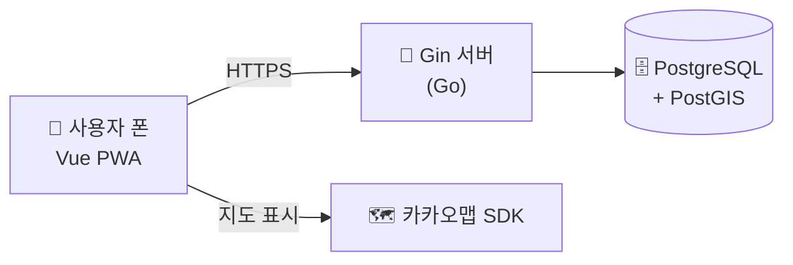
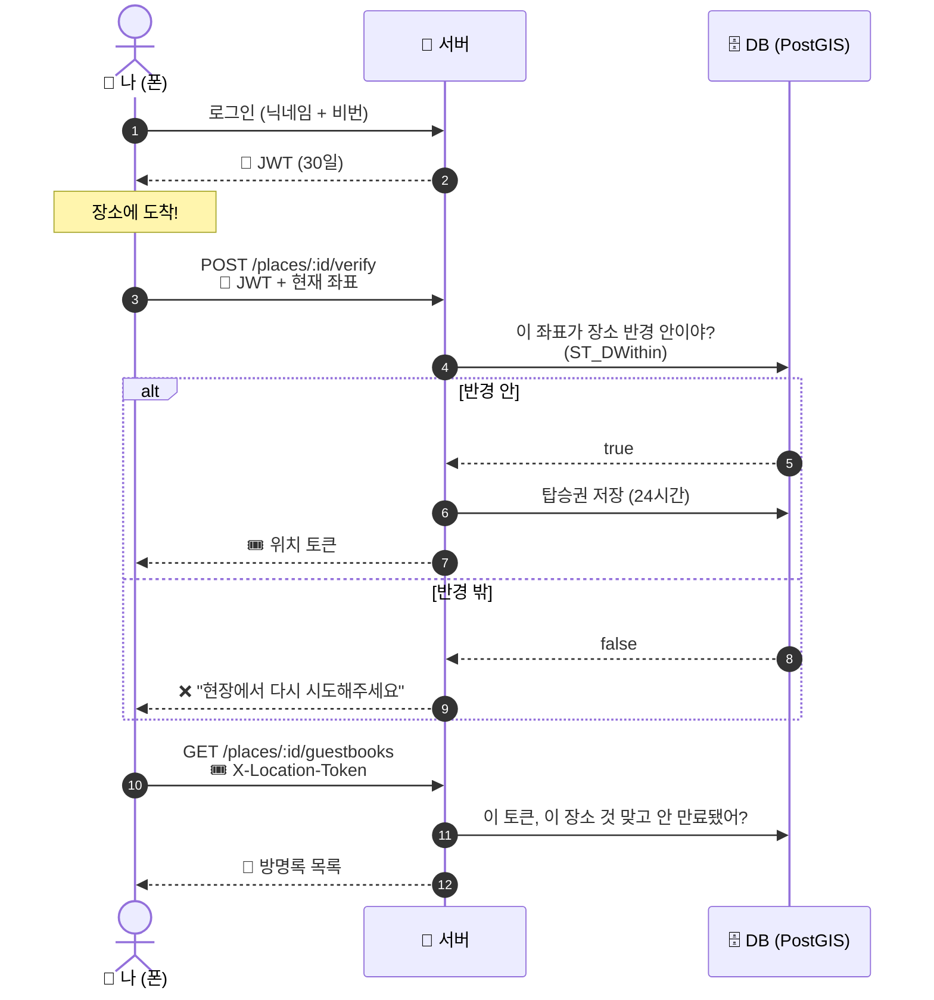
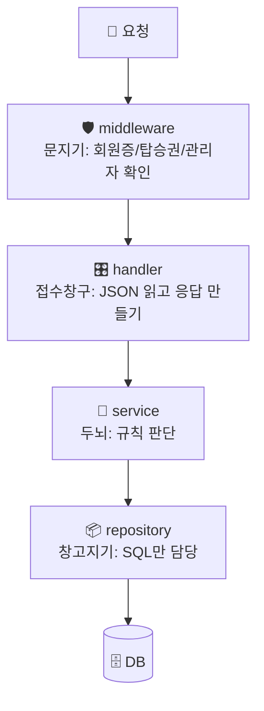
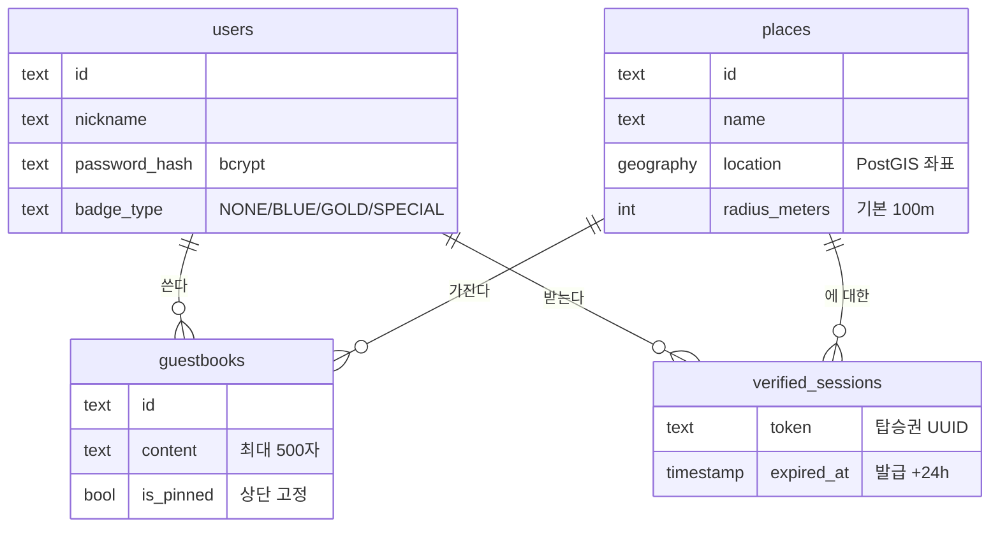

# herenote 설계 문서

> **한 줄 요약:** 그 장소에 **진짜로 가야만** 방명록을 읽고 쓸 수 있는 앱이에요.

---

## ⏱️ 30초 요약

- 📍 **장소마다 방명록이 하나씩** 있어요 (산 정상, 카페, 공원…)
- 🔒 방명록은 **GPS로 "지금 여기 있음"이 확인돼야** 열려요
- ✅ "여기 있음" 판정은 **서버가** 해요. 폰(프론트)은 좌표만 보내요
- 🎫 확인되면 **그 장소 전용 입장권(24시간)** 을 받아요

바쁘면 여기까지만 읽어도 돼요. 아래는 "어떻게"에 대한 이야기예요.

---

## 📚 목차

1. [전체 그림](#1-전체-그림)
2. [핵심 아이디어: 열쇠가 두 개](#2-핵심-아이디어-열쇠가-두-개)
3. [위치 인증은 이렇게 돌아가요](#3-위치-인증은-이렇게-돌아가요)
4. [코드는 이렇게 나뉘어 있어요](#4-코드는-이렇게-나뉘어-있어요)
5. [데이터는 이렇게 생겼어요](#5-데이터는-이렇게-생겼어요)
6. [보안에서 신경 쓴 것](#6-보안에서-신경-쓴-것)
7. [아직 부족한 점](#7-아직-부족한-점)

---

## 1. 전체 그림



| 조각 | 하는 일 | 기술 |
|---|---|---|
| 📱 프론트 | 화면, 지도, GPS 좌표 읽기 | Vue 3, Vite, PWA |
| 🚪 백엔드 | 로그인, 위치 판정, 방명록 저장 | Go, Gin |
| 🗄️ DB | 장소 좌표 저장, **거리 계산** | PostgreSQL + PostGIS |
| 🗺️ 지도 | 지도/썸네일 그리기 | 카카오맵 |

> 💡 **왜 PostGIS?** "이 좌표가 저 장소 반경 100m 안인가?"를 **DB가 한 줄 쿼리로** 답해줘요. 직접 거리 계산 코드를 짤 필요가 없어요.

---

## 2. 핵심 아이디어: 열쇠가 두 개

놀이공원에 비유해볼게요.

| 열쇠 | 비유 | 뭘 증명? | 유효기간 | 어디에 담겨서 와? |
|---|---|---|---|---|
| 🪪 **JWT** | 회원증 | **"나는 누구인가"** | 30일 | `Authorization: Bearer …` 헤더 |
| 🎟️ **위치 토큰** | 놀이기구 탑승권 | **"지금 거기 있는가"** | 24시간, **그 장소에서만** | `X-Location-Token` 헤더 |

- 회원증만 있으면 → 프로필 보기, 장소 목록 보기 가능
- 탑승권까지 있어야 → **그 장소의** 방명록 읽기/쓰기 가능
- A 장소 탑승권으로 B 장소 방명록은 **못 열어요**

> 💡 **왜 둘로 나눴냐면:** "누구"와 "어디"는 바뀌는 속도가 달라요. 사람은 그대로인데 위치는 계속 바뀌니까요. 하나로 합치면 위치가 바뀔 때마다 로그인을 다시 해야 해요.

---

## 3. 위치 인증은 이렇게 돌아가요



**단계별로 한 줄씩:**

1. 로그인하면 **회원증(JWT)** 을 받아요
2. 장소에 가서 "인증" 버튼 → 폰이 **현재 좌표**를 서버로 보내요
3. 서버가 DB한테 물어봐요: **"이 좌표, 반경 안이야?"**
4. 맞으면 **탑승권(UUID)** 을 만들어 DB에 저장하고 돌려줘요
5. 이후 방명록 요청마다 탑승권을 같이 보내요
6. 서버는 매번 **토큰 + 장소 + 만료시간**을 한꺼번에 확인해요

<details>
<summary>🔍 실제 쿼리가 궁금하면 펼치기</summary>

```sql
-- 위치 판정 (place_repository.go)
SELECT ST_DWithin(
    location::geography,
    ST_MakePoint($2, $3)::geography,  -- ⚠️ (경도, 위도) 순서!
    radius_meters
)
FROM places WHERE id = $1;

-- 탑승권 확인 (session_repository.go)
SELECT token, place_id, user_id, expired_at
FROM verified_sessions
WHERE token = $1
  AND place_id = $2        -- 다른 장소 토큰은 거절
  AND expired_at > NOW();  -- 만료된 토큰은 거절
```

`geography` 타입으로 바꿔서 계산하니까 결과가 **미터 단위**로 나와요.
</details>

---

## 4. 코드는 이렇게 나뉘어 있어요

요청 하나가 들어오면 **위에서 아래로** 한 칸씩 내려가요.



| 층 | 비유 | 하는 일 | 하면 **안 되는** 일 |
|---|---|---|---|
| 🛡️ middleware | 문지기 | 토큰 검사, 통과/거절 | 비즈니스 규칙 |
| 🎛️ handler | 접수창구 | 요청 파싱, 상태코드 결정 | SQL |
| 🧠 service | 두뇌 | "반경 밖이면 거절", "뱃지 있으면 상단 고정" | HTTP 몰라도 됨 |
| 📦 repository | 창고지기 | SQL 실행 | 판단하기 |

> 💡 **왜 이렇게 나눴냐면:** 한 층만 고치면 되게 하려고요. 예를 들어 DB를 바꾸면 repository만, 인증 방식을 바꾸면 middleware만 고치면 돼요.

**조립은 `main.go` 한 곳에서** 해요 (repository → service → handler 순서로 만들어서 넘겨줌). 전역 변수를 안 써서 테스트할 때 가짜를 끼워 넣기 쉬워요.

### 📁 폴더 지도

```
backend/
├── main.go          ← 조립 + 라우팅 (여기부터 읽기 시작!)
├── config/          ← 환경변수. 시크릿 없으면 서버 안 뜸
├── internal/
│   ├── auth/        ← JWT 만들기/검사
│   ├── middleware/  ← 🛡️ 문지기 4명 (CORS, UserAuth, LocationAuth, AdminOnly)
│   ├── handler/     ← 🎛️
│   ├── service/     ← 🧠
│   ├── repository/  ← 📦
│   └── model/       ← 데이터 모양 (struct)
└── pkg/gps/         ← Haversine 거리 계산 (예비용)

frontend/src/
├── views/           ← 화면 7개 (홈, 탐색, 프로필, 장소, 글쓰기, 로그인, 장소추가)
├── components/      ← 재사용 조각 (Hn 접두어)
├── stores/          ← 회원증/탑승권 보관
└── composables/     ← 카카오맵 로딩
```

---

## 5. 데이터는 이렇게 생겼어요

> ℹ️ 리포에 스키마 파일이 없어서, 아래는 **쿼리 코드에서 거꾸로 정리한** 모양이에요.



- **places** 📍 장소 좌표 + 허용 반경
- **verified_sessions** 🎟️ 발급된 탑승권 목록 (= 누가 언제 어디서 인증했나)
- **guestbooks** 📝 방명록 글. 정렬: **고정글 먼저 → 최신순**

---

## 6. 보안에서 신경 쓴 것

| ✅ 한 것 | 왜 중요해? |
|---|---|
| **위치 판정을 서버에서** | 프론트 코드를 고쳐서 "인증됨"으로 바꿔도 소용없어요. 탑승권은 서버만 만들 수 있으니까요 |
| **탑승권을 장소에 묶음** | 한 번 인증한 토큰으로 다른 장소를 열 수 없어요 |
| **비밀번호는 bcrypt 해시** | DB가 털려도 원래 비번은 안 보여요. JSON 응답에서도 `json:"-"`로 숨겨요 |
| **JWT 서명 알고리즘 고정** | HMAC이 아니면 거절해요 → `alg: none` 같은 공격을 막아요 |
| **카카오 REST 키는 서버에만** | 정적 지도 이미지는 `/api/static-map`이 대신 받아와요. 브라우저 번들에 서버용 키가 안 들어가요 |
| **JWT_SECRET 32자 미만이면 서버가 안 뜸** | 약한 기본값으로 실수로 배포하는 걸 막아요 |
| **관리자 = JWT의 user_id가 허용 목록에 있을 때만** | 예전엔 공유 시크릿 헤더였는데, 프론트 번들에 값이 노출돼서 바꿨어요 (테스트로 옛 방식이 안 먹히는 것도 확인함) |
| **로그인 실패 메시지 통일** | "닉네임 없음" / "비번 틀림"을 구분하지 않아서 아이디를 추측할 수 없어요 |

---

## 7. 아직 부족한 점

솔직하게 적어둘게요. 다음에 손볼 것들이에요.

- [ ] 🛰️ **GPS 위조는 못 막아요.** 서버는 폰이 보낸 좌표를 믿어요. 위치 조작 앱을 쓰면 뚫려요 → 정확도 값 검사, 짧은 시간에 너무 먼 거리 이동 감지 등이 필요해요
- [ ] 🌐 **CORS가 `*`** 예요 → 배포 도메인만 허용하도록 좁혀야 해요
- [x] 🏅 ~~뱃지 상단 고정이 실제로는 안 돼요.~~ → 글 작성 시점에 DB에서 작성자 뱃지를 직접 읽도록 수정 (`GuestbookService.shouldPin`)
- [ ] 🔄 **탑승권이 메모리에만 있어요** (프론트 `stores/verified.js`). 새로고침하면 다시 인증해야 해요
- [ ] 🚦 **로그인 시도 횟수 제한이 없어요** → 무차별 대입에 약해요
- [ ] 🗃️ **DB 스키마 파일이 리포에 없어요** → 마이그레이션 파일 추가 필요
- [ ] 🧪 테스트가 2개뿐이에요 (config, 관리자 미들웨어) → 위치 인증 흐름 테스트 추가 필요
- [ ] 📦 `go.mod`가 전부 `// indirect` → `go mod tidy` 필요
